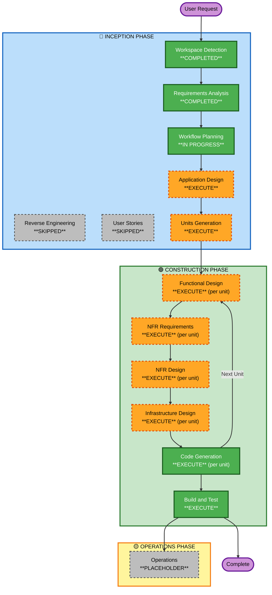

# Execution Plan

## Detailed Analysis Summary

### Transformation Scope
- **Project Type**: Greenfield — no existing code to modify
- **Primary Changes**: Build from scratch — Python API, AWS Blocks IaC, GitHub Actions CI/CD pipeline
- **Domains**: 3 distinct technical domains requiring independent design and implementation

### Change Impact Assessment
- **User-facing changes**: Yes — REST API with public endpoints via API Gateway
- **Structural changes**: Yes — multi-component architecture (app + infra + pipeline)
- **Data model changes**: No — stateless API, no database
- **API changes**: Yes — new API Gateway + Lambda endpoints
- **NFR impact**: Yes — security (OIDC, IAM least-privilege), observability (CloudWatch), cost (free tier)

### Risk Assessment
- **Risk Level**: Medium
- **Rollback Complexity**: Moderate (CDK destroy cleans up; pipeline config is declarative)
- **Testing Complexity**: Moderate (unit tests for app; IaC validation via cdk synth; pipeline smoke test)

---

## Workflow Visualization



**Text Alternative (for environments that don't render Mermaid)**:

```
INCEPTION PHASE
  [x] Workspace Detection      - COMPLETED
  [-] Reverse Engineering      - SKIPPED (Greenfield)
  [x] Requirements Analysis    - COMPLETED
  [-] User Stories             - SKIPPED (no user personas; infra + API project)
  [>] Workflow Planning        - IN PROGRESS
  [ ] Application Design       - EXECUTE
  [ ] Units Generation         - EXECUTE

CONSTRUCTION PHASE (per unit: app → infra → pipeline)
  [ ] Functional Design        - EXECUTE
  [ ] NFR Requirements         - EXECUTE
  [ ] NFR Design               - EXECUTE
  [ ] Infrastructure Design    - EXECUTE
  [ ] Code Generation          - EXECUTE
  [ ] Build and Test           - EXECUTE

OPERATIONS PHASE
  [ ] Operations               - PLACEHOLDER
```

---

## Stages to Execute

### 🔵 INCEPTION PHASE
- [x] Workspace Detection — COMPLETED
- [-] Reverse Engineering — SKIPPED (Greenfield — no existing code to analyze)
- [x] Requirements Analysis — COMPLETED
- [-] User Stories — SKIPPED
  - **Rationale**: No distinct user personas. This is an infrastructure + developer tooling project. The "users" are developers operating the pipeline — not distinct consumer personas requiring story mapping.
- [>] Workflow Planning — IN PROGRESS
- [ ] Application Design — **EXECUTE**
  - **Rationale**: Three new components (Python API, AWS Blocks IaC, CI/CD pipeline) with non-trivial interfaces between them. Component responsibilities, method signatures, and service interactions need to be defined before coding starts — especially the IaC construct structure and how the pipeline references the CDK app.
- [ ] Units Generation — **EXECUTE**
  - **Rationale**: Three clearly separable units of work with independent development paths and different tech stacks. Units: (1) `app` — Python REST API, (2) `infra` — AWS Blocks IaC, (3) `pipeline` — GitHub Actions + CodeBuild. Each unit has distinct dependencies: `pipeline` depends on `infra` outputs (Lambda ARN, API Gateway URL); `infra` depends on `app` build artifact.

### 🟢 CONSTRUCTION PHASE (per unit)

**Unit execution order**: `app` → `infra` → `pipeline` (dependency order)

#### Unit 1: `app` (Python REST API)
- [ ] Functional Design — **EXECUTE**
  - **Rationale**: API endpoint contracts, request/response shapes, error handling, Lambda handler adapter pattern, and pytest structure all need to be designed explicitly.
- [ ] NFR Requirements — **EXECUTE**
  - **Rationale**: Security extension is enabled. Need to document security requirements specific to the app layer: input validation, no secrets in code, structured logging, error responses that don't leak internals.
- [ ] NFR Design — **EXECUTE**
  - **Rationale**: Security patterns need to be incorporated into the design — Mangum adapter for Lambda, structured logging via Python logging module, safe error handling.
- [ ] Infrastructure Design — **SKIP**
  - **Rationale**: The `app` unit has no infrastructure of its own — it's a Python package. Infrastructure (Lambda function, API GW) belongs to the `infra` unit.
- [ ] Code Generation — **EXECUTE** (always)

#### Unit 2: `infra` (AWS Blocks IaC)
- [ ] Functional Design — **EXECUTE**
  - **Rationale**: Need to design the CDK stack structure — how AWS Blocks constructs map to Lambda + API Gateway + IAM + CloudWatch, how dev/prod environment separation is achieved, and what outputs the stack exports (API URL, Lambda ARN).
- [ ] NFR Requirements — **EXECUTE**
  - **Rationale**: Security extension requires explicit design of IAM least-privilege roles, CloudWatch log retention, and environment-specific config. Also need to decide on API Gateway type (HTTP vs REST API).
- [ ] NFR Design — **EXECUTE**
  - **Rationale**: Translate NFR requirements into concrete CDK/AWS Blocks constructs — IAM policy documents, log group retention settings, environment variable handling.
- [ ] Infrastructure Design — **EXECUTE**
  - **Rationale**: This unit IS the infrastructure design. Maps logical components (Lambda, API GW, IAM, CloudWatch) to specific AWS services and AWS Blocks construct patterns.
- [ ] Code Generation — **EXECUTE** (always)

#### Unit 3: `pipeline` (GitHub Actions + CodeBuild)
- [ ] Functional Design — **EXECUTE**
  - **Rationale**: Workflow YAML structure, job steps, environment variable passing, artifact handling, and the CodeBuild runner configuration all need to be designed before writing YAML.
- [ ] NFR Requirements — **EXECUTE**
  - **Rationale**: Security extension requires OIDC trust policy design, IAM role for CodeBuild, secret/variable management in GitHub Actions, and ensuring no credentials leak in logs.
- [ ] NFR Design — **EXECUTE**
  - **Rationale**: Design the OIDC provider setup, IAM assume-role policy, and GitHub Actions permission scopes (`id-token: write`).
- [ ] Infrastructure Design — **EXECUTE**
  - **Rationale**: The CodeBuild project itself is infrastructure (provisioned via CDK in the `infra` unit or separately). Need to design the CodeBuild project config, IAM role, and GitHub connection.
- [ ] Code Generation — **EXECUTE** (always)

#### After all units:
- [ ] Build and Test — **EXECUTE** (always)

### 🟡 OPERATIONS PHASE
- [ ] Operations — PLACEHOLDER

---

## Unit Dependency Graph

```
app (Unit 1)
  └── produces: zip artifact (Lambda deployment package)
        |
        v
infra (Unit 2)
  └── consumes: app zip artifact path
  └── produces: Lambda ARN, API Gateway URL (CloudFormation outputs)
        |
        v
pipeline (Unit 3)
  └── consumes: CDK app entry point, environment names
  └── produces: .github/workflows/ci.yml, .github/workflows/cd.yml, CodeBuild project config
```

**Development order**: `app` first (establish the deployable artifact), `infra` second (provision AWS resources), `pipeline` third (wire together the CI/CD flow).

---

## Estimated Timeline

- **Total Stages**: 17 execution stages across 3 units + 1 build & test
- **Estimated Duration**: Depends on review/approval pace — each unit has 4–5 stages with approval gates
- **Skipped Stages**: Reverse Engineering, User Stories, Infrastructure Design for `app` unit

## Success Criteria

- **Primary Goal**: A fully working IaC + CI/CD project that passes the assignment requirements
- **Key Deliverables**:
  1. AWS Blocks CDK app deploying Lambda + API GW in dev and prod
  2. GitHub Actions CI/CD pipeline with CodeBuild runner
  3. Python Flask/FastAPI API with unit tests
  4. README with architecture decisions, pipeline config, and IaC comparison
- **Quality Gates**:
  - Security extension compliance at every construction stage
  - `cdk synth` succeeds (IaC validates)
  - Unit tests pass
  - No hardcoded credentials
  - OIDC used for AWS auth in pipeline
